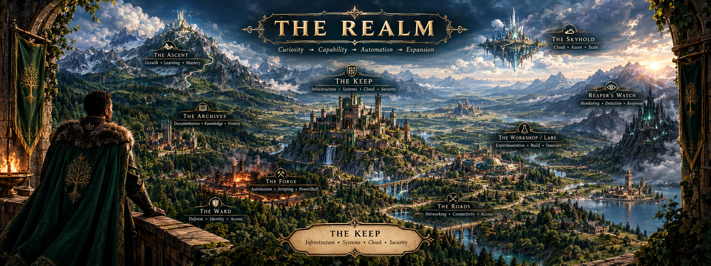
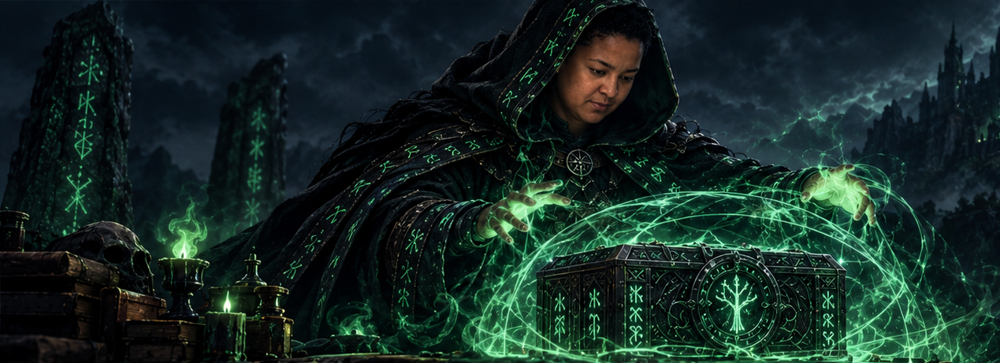
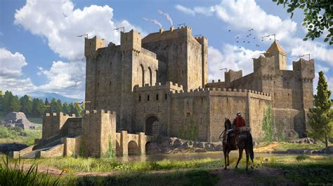
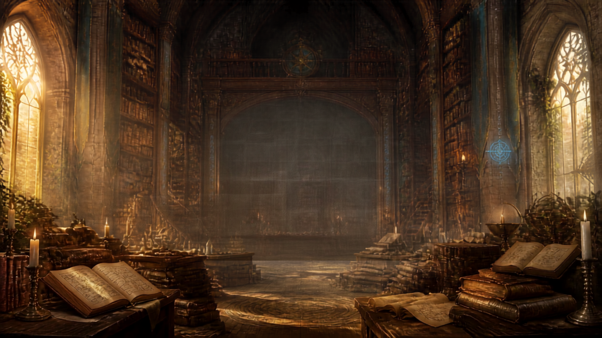
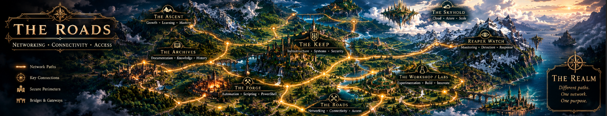
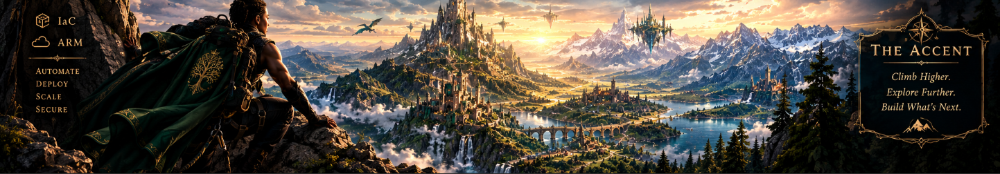
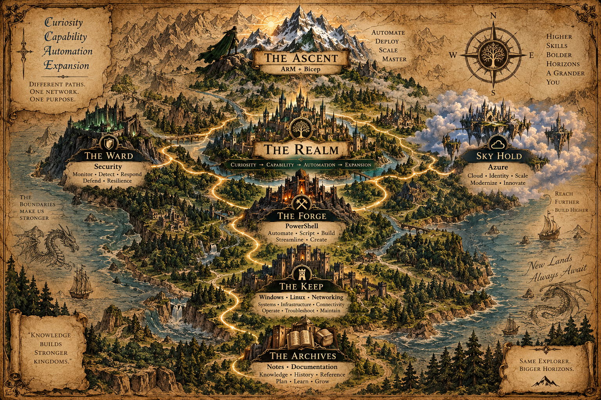

<div align="center">



<br>

⚔️ THE REALM

THE HYBRID CLOUD INFRASTRUCTURE LAB

☁️ Azure   ✦   ⚙️ PowerShell   ✦   🛡️ Security   ✦   🏗️ Automation

<br>

Curiosity → Capability → Automation → Expansion

Build. Secure. Automate. Expand.

</div>

## Lourie Glass

Army veteran (MQ-1C operator and Aircraft Commander) moving into **SOC, NOC and IT support** work. CompTIA Security+ and Network+. Dallas-Fort Worth. [LinkedIn](https://www.linkedin.com/in/glass510)

### Start here

| Project | What it shows | Result |
| --- | --- | --- |
| [The Ward](https://github.com/Lglass510/The_Ward_Sentinel_Soar) | Microsoft Sentinel detection for Entra ID privilege escalation (MITRE T1098.003), investigation write-up, Logic App playbook that disables the account | The first playbook build reported success and disabled no one. I audited it, fixed five configuration bugs, and verified the fix in the audit logs |
| [The Ascent](https://github.com/Lglass510/The_Ascent_Bicep_Sentinel) | The Ward rebuilt as code with Bicep and PowerShell | Rebuilt from an empty resource group in 1 min 9 s; the rebuilt playbook disabled a test attacker 15 s after the incident opened |
| [AD bulk onboarding](https://github.com/Lglass510/The_Keep/tree/main/ActiveDirectory) | Help desk account provisioning with PowerShell | 206-record new-hire CSV: 10 managers, 201 employee accounts, 5 department OUs, manager links, 2 security groups |
| [DC1 vulnerability assessment](https://github.com/Lglass510/The_Keep/tree/main/VulnerabilityAssessment) | nmap from Kali against my own domain controller, then patch-level checks from the inside | Found the DC unpatched and Windows Update failing |
| [Hyper-V NAT troubleshooting](https://github.com/Lglass510/The_Keep/tree/main/Networking/Hyper-V-NAT-Gateway) | Layer-by-layer network troubleshooting | Ping failed while TCP and DNS worked; traced to a missing default gateway and a DNS forwarder problem |

<br>

🧭 ENTER THE REALM

Welcome to THE REALM, my hands-on cloud infrastructure environment.

This is where I document the transition from systems administration into Azure infrastructure, PowerShell automation, and cloud security: building real environments, understanding how they work, securing them, and eventually defining them as code.

My purpose: Build the infrastructure. Secure the environment. Automate the work. Expand the capability.

<br>

<table>
<tr>
<td width="33%" valign="top">

<a href="https://github.com/Lglass510/The_Sky_Hold">

</a>

🏰 SKY HOLD

AZURE INFRASTRUCTURE

Build the foundation.

Virtual Networks and Subnets

Network Security Groups

Storage Hardening

Az PowerShell and Azure CLI

AZ-104 Lab Work

<a href="https://github.com/Lglass510/The_Sky_Hold">→ Enter Sky Hold</a>

</td>

<td width="33%" valign="top">

<a href="https://github.com/Lglass510/The_Forge">

</a>

⚙️ THE FORGE

POWERSHELL AUTOMATION

Turn knowledge into capability.

PowerShell Module (MavLabTools)

Remoting to the Domain Controller

Idempotent AD Functions

Azure Storage Baseline Script

<a href="https://github.com/Lglass510/The_Forge">→ Enter the Forge</a>

</td>

<td width="33%" valign="top">

<a href="https://github.com/Lglass510/The_Ward_Sentinel_Soar">

</a>

🛡️ THE WARD

DETECTION & RESPONSE

Protect the environment.

Microsoft Sentinel

KQL Detection (T1098.003)

SOAR Playbooks

Entra ID Security

Least-Privilege Automation

Incident Response

<a href="https://github.com/Lglass510/The_Ward_Sentinel_Soar">→ Enter the Ward</a>

</td>
</tr>
</table>

🏛️ THE KEEP

<a href="https://github.com/Lglass510/The_Keep">

</a>

SYSTEMS & INFRASTRUCTURE FOUNDATIONS

Before the cloud, there is infrastructure.

The Keep represents the foundation behind everything I build in Azure: understanding operating systems, identity, networking, and the systems that make modern infrastructure work.

⚔️ Foundation

Focus

🖥️ Windows

Administration & troubleshooting

👥 Active Directory

Identity & access

🐧 Linux

System administration

🌐 Networking

Connectivity & infrastructure

🖧 Virtualization

Hands-on environments

🔧 Troubleshooting

Understanding systems

Understand the system before attempting to automate it.

<a href="https://github.com/Lglass510/The_Keep">→ Enter the Keep</a>

📜 THE ARCHIVES

<a href="https://github.com/Lglass510/The_Archives">

</a>

NOTES & DOCUMENTATION

The Archives are where knowledge becomes reusable.

Here I collect technical notes, command references, lessons learned, study material, and documentation from the environments I build.

📘 Azure Notes
⚙️ PowerShell Notes
🛡️ Security Notes
🐧 Linux Notes
🌐 Networking Notes
📋 Cheat Sheets
🧠 Lessons Learned

Knowledge preserved. Capability expanded.

<a href="https://github.com/Lglass510/The_Archives">→ Enter the Archives</a>

🌐 THE ROADS

<a href="https://github.com/Lglass510/The_Roads">

</a>

CONNECTIVITY & ARCHITECTURE

Every system is connected.

The Roads are the darker side of the realm—a place where connectivity, exposure, routing, DNS, and network security meet.

🌐 Networking
🔗 Connectivity
📡 DNS
🔀 Routing
🛡️ Network Security
☁️ Azure Networking

Understand what connects the realm. Secure what crosses it.

<a href="https://github.com/Lglass510/The_Roads">→ Enter the Roads</a>

🏔️ THE ASCENT

<a href="https://github.com/Lglass510/The_Ascent_Bicep_Sentinel">

</a>

INFRASTRUCTURE AS CODE

The Ward, rebuilt as code.

I built The Ward by hand in the Azure portal. The Ascent defines the whole thing in Bicep, so it can be deleted and brought back with one deployment and two PowerShell scripts.

I tore it down and rebuilt it from an empty resource group: the deployment finished in 1 minute 9 seconds with no portal clicks. Then the rebuilt system caught a live privilege escalation and disabled the account 15 seconds after the incident opened.

```text
Azure Administration
        ↓
PowerShell Automation
        ↓
Azure Security
        ↓
Bicep
        ↓
Infrastructure as Code ✓
```

Built With

🏗️ Bicep modules, outputs, and `existing` references
📦 One-command deploys with `.bicepparam`
🔁 Idempotent names with `guid()`
⚙️ PowerShell post-deploy scripts (Graph permissions, Entra log routing)
🛡️ Least-privilege RBAC for the playbook's managed identity

The goal is no longer simply managing infrastructure. The goal is defining infrastructure.

<a href="https://github.com/Lglass510/The_Ascent_Bicep_Sentinel">→ Enter the Ascent</a>

⚔️ CURRENT QUESTS

🛡️ Security+ (certified)

Applying security fundamentals to the cloud environments I build.

☁️ Azure

Building practical cloud infrastructure and administration skills.

⚙️ PowerShell

Developing automation for infrastructure administration and Azure workflows.

🏔️ Bicep

The Ward now rebuilds from code. Next: Defender for Cloud and Azure Policy, remediating a deliberately misconfigured subscription and recording the before and after.

🗺️ THE ROADMAP



```text
                         🏔️ THE ASCENT
                         Bicep (complete)
                                ↑
        🛡️ THE WARD  ←──────  The Realm  ──────→  🏰 SKY HOLD
          Security                              Azure
                                ↑
                          ⚙️ THE FORGE
                            PowerShell
                                ↑
                           🏛️ THE KEEP
                  Windows • Linux • Networking
                                ↑
                         📜 THE ARCHIVES
                      Notes • Documentation
```

<div align="center">

⚔️ THE REALM PRINCIPLES

✦ Curiosity

Ask how the system works.

⚔️ Capability

Learn to build and administer it.

⚙️ Automation

Make the work repeatable.

🏔️ Expansion

Build something larger.

<br>

Curiosity → Capability → Automation → Expansion

<br>

☁️ Build the infrastructure.

🛡️ Secure the environment.

⚙️ Automate the work.

🏔️ Expand the capability.

<br>

The lab is never finished. The realm keeps expanding.

</div>

